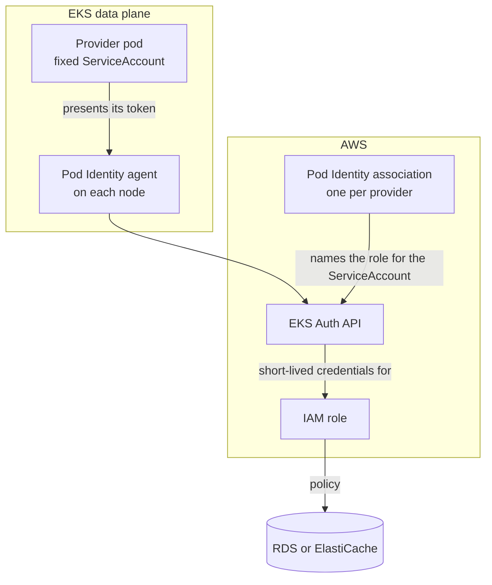

# AWS Backing

This backing builds the module's resources on AWS, using the Crossplane providers from the
[AWS provider family](https://github.com/crossplane-contrib/provider-upjet-aws). The providers
authenticate with EKS Pod Identity, so no cloud credential is stored in the cluster. Databases and
caches are created in the data plane's VPC, in its private subnets, with no public endpoint.

For how the module fits together, see the [module README](../README.md).

| Resource | Built as | Provider | Composition |
| :------- | :------- | :------- | :---------- |
| PostgreSQL | Amazon RDS for PostgreSQL | `provider-aws-rds` | [`postgres-composition.yaml`](postgres-composition.yaml) |
| Redis | Amazon ElastiCache for Valkey | `provider-aws-elasticache` | [`redis-composition.yaml`](redis-composition.yaml) |

| File | What it is |
| :--- | :--------- |
| [`provider.yaml`](provider.yaml) | The providers, each with a fixed ServiceAccount name for Pod Identity |
| [`provider-config.yaml`](provider-config.yaml) | Tells the providers to use Pod Identity |
| [`environment-config.yaml`](environment-config.yaml) | This data plane's AWS settings, read by every Composition |
| `<resource>-composition.yaml` | One Composition per resource |
| `render/<resource>/` | Sample inputs for checking a Composition without a cluster |

## How the providers authenticate

Each provider runs as its own pod, under a ServiceAccount with a fixed name. A Pod Identity
association in EKS links that ServiceAccount to an IAM role. When the pod starts, EKS gives it a
token and the address of the Pod Identity agent on its node. The agent exchanges the token with EKS
for short-lived credentials for the role, and the role's policies decide what the provider can do.

The role's trust policy names only the EKS Pod Identity service, not a cluster or ServiceAccount, so
the association alone decides which pods get it.



## Prerequisites

- Steps 1 to 4 of the [module install](../README.md#install) done on this data plane
- The OpenChoreo data plane running on EKS, with the EKS Pod Identity Agent add-on
  (`eks-pod-identity-agent`)
- Permission to create IAM roles and CloudFormation stacks (eksctl creates each role through a
  stack), Pod Identity associations, a security group and subnet groups
- The AWS CLI and [eksctl](https://eksctl.io)

## Install

Run these from the module's root directory, against the cluster running the OpenChoreo data plane.

```bash
CLUSTER=<EKS cluster name>
REGION=<region of the cluster>
```

### 1. Create an IAM role for each provider

Create one role per provider, with a Pod Identity association for the provider's ServiceAccount, as
described in [How the providers authenticate](#how-the-providers-authenticate). eksctl creates both
in one step:

```bash
cat > pod-identity.yaml <<EOF
apiVersion: eksctl.io/v1alpha5
kind: ClusterConfig
metadata:
  name: $CLUSTER
  region: $REGION
iam:
  podIdentityAssociations:
    # Crossplane creates the ServiceAccounts, so eksctl must not.
    - namespace: crossplane-system
      serviceAccountName: provider-aws-rds
      createServiceAccount: false
      permissionPolicyARNs:
        - arn:aws:iam::aws:policy/AmazonRDSFullAccess
    - namespace: crossplane-system
      serviceAccountName: provider-aws-elasticache
      createServiceAccount: false
      permissionPolicyARNs:
        - arn:aws:iam::aws:policy/AmazonElastiCacheFullAccess
EOF

eksctl create podidentityassociation -f pod-identity.yaml
```

Leave out the providers for resources this data plane does not offer. Keep `pod-identity.yaml` for
the [uninstall](#uninstall).

The AWS managed policies cover every region of the account, and grant more than the providers use.
`AmazonRDSFullAccess` allows every RDS action on every RDS resource, and also reading any CloudWatch
Logs log events, publishing to any SNS topic, and managing CloudWatch alarms and Application Auto
Scaling. `AmazonElastiCacheFullAccess` allows every ElastiCache action, and creating the VPC
endpoints that ElastiCache Serverless uses. Use an account that holds only resources this backing
creates, or replace them with narrower policies.

For each entry, eksctl creates a CloudFormation stack with an IAM role whose trust policy allows the
service `pods.eks.amazonaws.com` the actions `sts:AssumeRole` and `sts:TagSession`, attaches the
policy to it, and creates the association. Other tooling can create the same.

### 2. Install the providers

Create the associations before the providers. EKS gives credentials only to pods started after an
association exists. A provider pod started earlier has none, and one that was running when its
association or role was recreated keeps the credentials it cached for the old role, which AWS
rejects with `InvalidClientTokenId`. In either case, delete the provider pod so it starts again.

```bash
kubectl apply -f aws/provider.yaml
kubectl wait providers.pkg.crossplane.io --all --for=condition=Healthy --timeout=10m
```

Installing a provider from the family also installs `provider-family-aws`, which owns the
ProviderConfig types and needs no AWS access. Each provider's ServiceAccount name is fixed in its
`DeploymentRuntimeConfig`, so the association from step 1 keeps matching across provider upgrades.

Check that EKS gave each provider pod its credentials:

```bash
for POD in $(kubectl get pods -n crossplane-system -o name | grep -E 'provider-aws-(rds|elasticache)'); do
  echo "$POD: $(kubectl get -n crossplane-system "$POD" -o jsonpath='{.spec.containers[0].env[*].name}')"
done
```

The output should include `AWS_CONTAINER_CREDENTIALS_FULL_URI` and
`AWS_CONTAINER_AUTHORIZATION_TOKEN_FILE`. If it does not, check the association's namespace and
ServiceAccount name, then delete the provider pod so it starts again. Step 4 ends with a check that
the credentials work.

### 3. Configure the provider credentials

Apply [`provider-config.yaml`](provider-config.yaml). It has nothing to edit: each provider acts as
the role its association names.

```bash
kubectl apply -f aws/provider-config.yaml
```

AWS resources in any namespace use the `ClusterProviderConfig` named `default` unless they say
otherwise, so this one object covers every cell namespace. It also means that anyone who can create
AWS managed resources (`*.aws.m.upbound.io`) in any namespace on the data plane acts with the
providers' IAM roles. Keep that permission to platform engineers.

### 4. Create the networking

Databases and caches go into the data plane's VPC, in its private subnets. Create, once per data
plane, a security group that admits the cluster's pods, and a subnet group for each service:

```bash
VPC_ID=$(aws eks describe-cluster --name "$CLUSTER" --region "$REGION" \
  --query cluster.resourcesVpcConfig.vpcId --output text)
CLUSTER_SG=$(aws eks describe-cluster --name "$CLUSTER" --region "$REGION" \
  --query cluster.resourcesVpcConfig.clusterSecurityGroupId --output text)

# Pick the VPC's private subnets, in at least two availability zones
aws ec2 describe-subnets --region "$REGION" --filters "Name=vpc-id,Values=$VPC_ID" \
  --query 'Subnets[].[SubnetId,AvailabilityZone,MapPublicIpOnLaunch]' --output table
PRIVATE_SUBNETS=(<subnet-id> <subnet-id>)

SG=$(aws ec2 create-security-group --region "$REGION" --vpc-id "$VPC_ID" \
  --group-name openchoreo-crossplane \
  --description "RDS and ElastiCache created by Crossplane for OpenChoreo" \
  --query GroupId --output text)
aws ec2 authorize-security-group-ingress --region "$REGION" --group-id "$SG" --ip-permissions \
  "IpProtocol=tcp,FromPort=5432,ToPort=5432,UserIdGroupPairs=[{GroupId=$CLUSTER_SG}]" \
  "IpProtocol=tcp,FromPort=6379,ToPort=6379,UserIdGroupPairs=[{GroupId=$CLUSTER_SG}]" \
  --query 'SecurityGroupRules[].SecurityGroupRuleId' --output text

aws rds create-db-subnet-group --region "$REGION" \
  --db-subnet-group-name openchoreo-crossplane \
  --db-subnet-group-description "Private subnets for RDS created by Crossplane for OpenChoreo" \
  --subnet-ids "${PRIVATE_SUBNETS[@]}" --query DBSubnetGroup.SubnetGroupStatus --output text
aws elasticache create-cache-subnet-group --region "$REGION" \
  --cache-subnet-group-name openchoreo-crossplane \
  --cache-subnet-group-description "Private subnets for ElastiCache created by Crossplane for OpenChoreo" \
  --subnet-ids "${PRIVATE_SUBNETS[@]}" --query CacheSubnetGroup.CacheSubnetGroupName --output text

echo "$SG"
```

The rules admit the EKS cluster security group. In an EKS managed node group without security groups
of its own, every node carries that group, and with the VPC CNI's default setup pod traffic carries
the node's groups. If the cluster uses security groups for pods, or nodes with other security
groups, admit those instead.

The security group's rules reference the cluster security group. Delete it before deleting the EKS
cluster, or the cluster's security group, and with it the VPC, cannot be deleted.

Check that the providers' credentials work, without creating anything, by observing the two subnet
groups. `managementPolicies: ["Observe"]` only reads; deleting the objects leaves AWS untouched.

```bash
kubectl apply -f - <<EOF
apiVersion: rds.aws.m.upbound.io/v1beta1
kind: SubnetGroup
metadata:
  name: credentials-check
  namespace: default
  annotations:
    crossplane.io/external-name: openchoreo-crossplane
spec:
  managementPolicies: ["Observe"]
  forProvider:
    region: $REGION
---
apiVersion: elasticache.aws.m.upbound.io/v1beta1
kind: SubnetGroup
metadata:
  name: credentials-check
  namespace: default
  annotations:
    crossplane.io/external-name: openchoreo-crossplane
spec:
  managementPolicies: ["Observe"]
  forProvider:
    region: $REGION
EOF
kubectl wait -n default subnetgroups.rds.aws.m.upbound.io/credentials-check \
  subnetgroups.elasticache.aws.m.upbound.io/credentials-check --for=condition=Ready --timeout=2m
kubectl delete -n default subnetgroups.rds.aws.m.upbound.io/credentials-check \
  subnetgroups.elasticache.aws.m.upbound.io/credentials-check
```

If they stay not ready, `kubectl describe` on them shows the error from AWS.

### 5. Configure this data plane's settings

Edit [`environment-config.yaml`](environment-config.yaml) with the region, the security group and
the subnet groups from step 4 (see [Settings](#settings)), then apply it.

```bash
kubectl apply -f aws/environment-config.yaml
```

### 6. Install the Compositions

Apply the Composition for each resource this data plane should offer:

```bash
kubectl apply -f aws/postgres-composition.yaml
kubectl apply -f aws/redis-composition.yaml
```

Then return to the [module install](../README.md#6-add-the-resourcetypes) to add the ResourceTypes.

## Settings

Every AWS Composition reads the `aws` EnvironmentConfig on its data plane. These settings are shared
by all of them. Each resource's settings are under its own key, described in that resource's section
below.

| Field | Purpose |
| :---- | :------ |
| `region` | AWS region for new resources: the region of the data plane's VPC |
| `namePrefix` | Prepended to the name of every AWS resource the Compositions create. Lowercase letters, digits and hyphens, starting with a letter |
| `securityGroupIds` | Security groups attached to every database and cache. Together they must admit the data plane's pods on each resource's port |
| `tags` | Optional. Tags added to every AWS resource the Compositions create. Values are written as strings |

The provider also tags each resource with `crossplane-kind`, `crossplane-name` and
`crossplane-providerconfig`, which lead from the AWS console back to the managed resource.

> [!WARNING]
> The provider finds an ElastiCache replication group by its ID. If a new cache's ID matches one
> Crossplane did not create, it takes that cache over, and deleting the Resource deletes it. Keep
> `namePrefix` distinct from anything else in the account and region.
>
> The Compositions only reference the subnet groups (by name) and the security groups (by ID) and
> never manage them, so deleting a Resource never touches the networking.

## Checking a Composition

`crossplane composition render` runs a Composition's functions locally, in Docker, and prints what
Crossplane would create, without a cluster. Each resource has sample inputs under
`render/<resource>/`: a composite resource, and the AWS resource as it looks once AWS has finished.
Run the commands in each resource's section from the module's root directory.

With Colima, point the CLI at its socket first:
`export DOCKER_HOST=unix://$HOME/.colima/default/docker.sock`.

## PostgreSQL

[`postgres-composition.yaml`](postgres-composition.yaml) builds a `PostgresInstance` as an Amazon
RDS for PostgreSQL instance.

### What it creates

For each `PostgresInstance`, in the same namespace:

| Resource | Purpose |
| :------- | :------ |
| `Instance` | The database instance, with the application database created with it. Encrypted gp3 storage, not publicly accessible. The provider generates the master password into the Secret `<name>-conn`, under `password`, and deletes the Secret with the instance. The Secret holds nothing else |

### Outputs

| [Output](../apis/postgres/README.md#outputs) | Filled from |
| :----- | :---------- |
| `host` | The instance's endpoint address |
| `port` | `5432` |
| `database` | The database it created |
| `username` | `postgres.username` |
| `password` | The Secret `<name>-conn` |

### Settings

Under `postgres` in the `aws` EnvironmentConfig:

| Field | Purpose |
| :---- | :------ |
| `subnetGroupName` | Existing DB subnet group over the VPC's private subnets |
| `username` | Master user for new instances. RDS reserves some names, such as `rdsadmin` |

Instance identifiers are unique per account and region, limited to 63 letters, digits and hyphens,
with no two hyphens in a row. Each identifier is `namePrefix`, the `PostgresInstance` name and a
short hash of its namespace, so Resources with the same name in different OpenChoreo namespaces or
projects get different instances. Identifiers that would be too long, or that had hyphens to
collapse, are shortened, with a hash of the full name appended. An instance keeps its identifier
once created.

On RDS the `database` parameter must start with a letter.

### Sizes

| `size` | Instance class | Storage |
| :----- | :------------- | :------ |
| `small` | `db.t4g.small` | 32 GiB |
| `medium` | `db.m7g.large` | 64 GiB |
| `large` | `db.m7g.xlarge` | 128 GiB |

Every size runs in a single availability zone. Only `small` has been tested against AWS; `medium`
and `large` have been checked against the provider's schema.

The Composition sets the major version only, and RDS picks its default minor version (16.13 for
`"16"` at the time of testing).

Changing an existing database's size or version has not been tested. RDS cannot reduce an instance's
allocated storage, so a smaller size does not apply to an existing database, and a new major version
needs `allowMajorVersionUpgrade`, which the Composition does not set.

> [!WARNING]
> Deleting the binding deletes the database and its automated backups, with no final snapshot. Take
> a snapshot first if the data matters.

### Networking

The instance has no public endpoint. It accepts connections only from sources the security groups
in `securityGroupIds` admit. Connections use TLS; clients should connect with `sslmode=require`.

### What to expect

- **A new database takes about eleven minutes to reach the Workload.** In testing (`small`,
  us-east-1), AWS had the instance available, and the `PostgresInstance` Ready, after about five
  and a half minutes. The binding followed about five minutes later, and a dependent component
  connected straight after.
- **Deletion is quick.** AWS removed the instance under two minutes after the binding was deleted,
  and `<name>-conn` went with it. No snapshot or backup was left behind.

### Checking the Composition

```bash
# First reconcile: nothing exists in AWS yet
crossplane composition render aws/render/postgres/xr.yaml aws/postgres-composition.yaml functions.yaml \
  --xrd apis/postgres/definition.yaml \
  --required-resources aws/environment-config.yaml

# A later reconcile: the PostgresInstance gets its address and becomes Ready
crossplane composition render aws/render/postgres/xr.yaml aws/postgres-composition.yaml functions.yaml \
  --xrd apis/postgres/definition.yaml \
  --required-resources aws/environment-config.yaml \
  --observed-resources aws/render/postgres/observed.yaml
```

## Redis

[`redis-composition.yaml`](redis-composition.yaml) builds a `RedisInstance` as an Amazon
ElastiCache for Valkey replication group. Valkey is an open-source fork of Redis that speaks the
same protocol; it reports itself to clients as Redis 7.2.4.

### What it creates

For each `RedisInstance`, in the same namespace:

| Resource | Purpose |
| :------- | :------ |
| `ReplicationGroup` | The cache, with cluster mode off, so clients connect to a single primary endpoint. TLS-only connections, encryption at rest and an auth token. The provider generates the auth token into the Secret `<name>-conn`, under `password`, and deletes the Secret with the cache. The Secret holds nothing else |

The Composition sets no engine version, so AWS uses its default at creation (Valkey 9.1 at the time
of testing).

### Outputs

| [Output](../apis/redis/README.md#outputs) | Filled from |
| :----- | :---------- |
| `host` | The primary endpoint address |
| `port` | `6379` |
| `password` | The Secret `<name>-conn` |

Clients connect with TLS and authenticate with the token alone, with no username.

### Settings

Under `redis` in the `aws` EnvironmentConfig:

| Field | Purpose |
| :---- | :------ |
| `subnetGroupName` | Existing ElastiCache subnet group over the VPC's private subnets |

Replication group IDs are unique per account and region, limited to 40 letters, digits and hyphens,
with no two hyphens in a row. Each ID is `namePrefix`, the `RedisInstance` name and a short hash of
its namespace, so Resources with the same name in different OpenChoreo namespaces or projects get
different caches. IDs that would be too long, which most are, or that had hyphens to collapse, are
shortened, with a hash of the full name appended. A cache keeps its ID once created.

### Sizes

| `size` | Node type | Nodes |
| :----- | :-------- | :---- |
| `small` | `cache.t4g.micro` | 1 |
| `medium` | `cache.t4g.small` | 2, in different zones, with automatic failover |
| `large` | `cache.t4g.medium` | 2, in different zones, with automatic failover |

Only `small` has been tested against AWS; `medium` and `large` have been checked against the
provider's schema. Changing an existing cache's size has not been tested.

### Networking

The cache has no public endpoint. It accepts connections only from sources the security groups in
`securityGroupIds` admit.

### What to expect

- **A new cache takes about twelve minutes to reach the Workload.** In testing (`small`,
  us-east-1), AWS had the cache available, and the `RedisInstance` Ready, after about six minutes.
  The binding followed about five minutes later, and a dependent component connected straight
  after.
- **Deletion takes a few minutes.** AWS removed the cache about seven minutes after the binding was
  deleted, and `<name>-conn` went with it.
- **AWS will not list a cache's tags until it is available.**

### Checking the Composition

```bash
# First reconcile: nothing exists in AWS yet
crossplane composition render aws/render/redis/xr.yaml aws/redis-composition.yaml functions.yaml \
  --xrd apis/redis/definition.yaml \
  --required-resources aws/environment-config.yaml

# A later reconcile: the RedisInstance gets its address and port, and becomes Ready
crossplane composition render aws/render/redis/xr.yaml aws/redis-composition.yaml functions.yaml \
  --xrd apis/redis/definition.yaml \
  --required-resources aws/environment-config.yaml \
  --observed-resources aws/render/redis/observed.yaml
```

## Uninstall

Delete every binding of a Resource built by this backing first, and wait until no AWS managed
resource is left. If a provider is removed while its resources still exist, they keep running in
AWS with nothing left to delete them.

```bash
# 1. Confirm no managed resources are left
kubectl get managed -A

# 2. Remove the Compositions, the settings, the credentials and the providers
kubectl delete --ignore-not-found -f aws/postgres-composition.yaml -f aws/redis-composition.yaml
kubectl delete -f aws/environment-config.yaml
kubectl delete -f aws/provider-config.yaml
kubectl delete -f aws/provider.yaml
kubectl delete providers.pkg.crossplane.io crossplane-contrib-provider-family-aws

# 3. In AWS: the networking, then the Pod Identity associations and their roles
VPC_ID=$(aws eks describe-cluster --name "$CLUSTER" --region "$REGION" \
  --query cluster.resourcesVpcConfig.vpcId --output text)
SG=$(aws ec2 describe-security-groups --region "$REGION" \
  --filters "Name=vpc-id,Values=$VPC_ID" Name=group-name,Values=openchoreo-crossplane \
  --query 'SecurityGroups[0].GroupId' --output text)
aws elasticache delete-cache-subnet-group --region "$REGION" --cache-subnet-group-name openchoreo-crossplane
aws rds delete-db-subnet-group --region "$REGION" --db-subnet-group-name openchoreo-crossplane
aws ec2 delete-security-group --region "$REGION" --group-id "$SG"
eksctl delete podidentityassociation -f pod-identity.yaml
```

Then continue with the [module uninstall](../README.md#uninstall).

## Compatibility

| Component | Compatible version | Notes |
| :-------- | :----------------- | :---- |
| **provider-aws-rds** | `v2.9.x` | Verified against v2.9.0, from `xpkg.crossplane.io/crossplane-contrib`. Uses the namespaced `*.aws.m.upbound.io` API groups. |
| **provider-aws-elasticache** | `v2.9.x` | Verified against v2.9.0, from `xpkg.crossplane.io/crossplane-contrib`. |
| **EKS** | `1.36` | Verified on EKS 1.36.4 with the Pod Identity agent add-on v1.3.10. |
